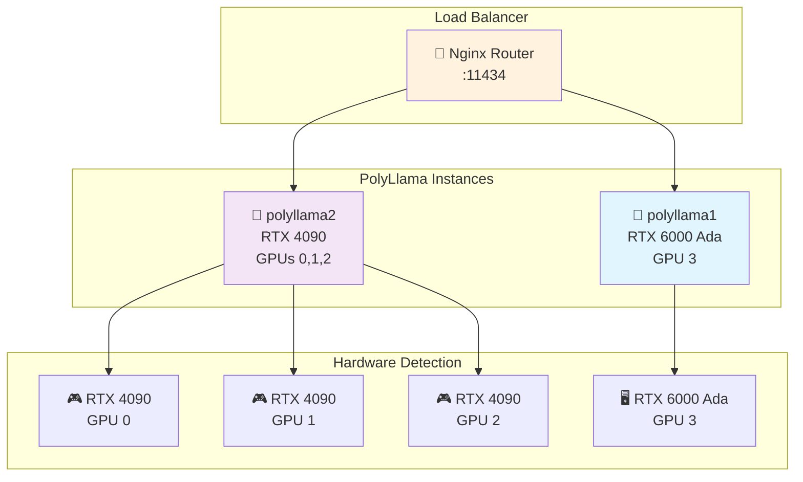
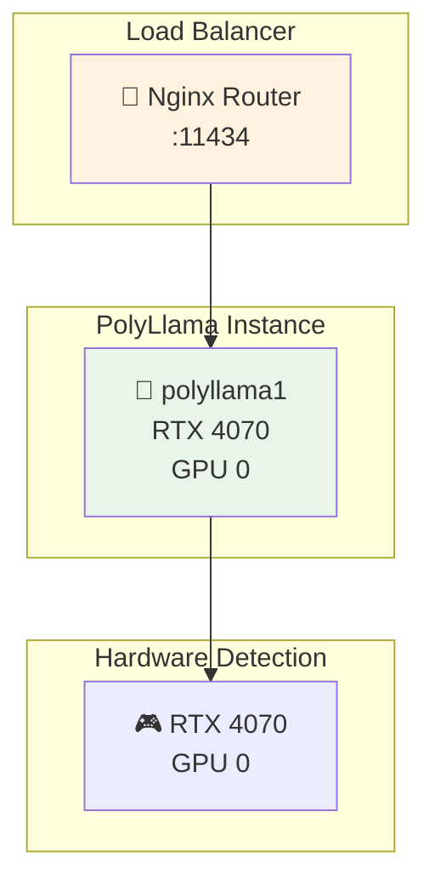
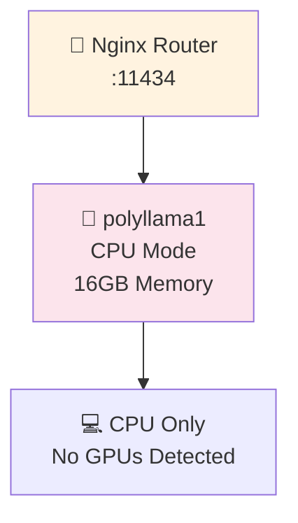
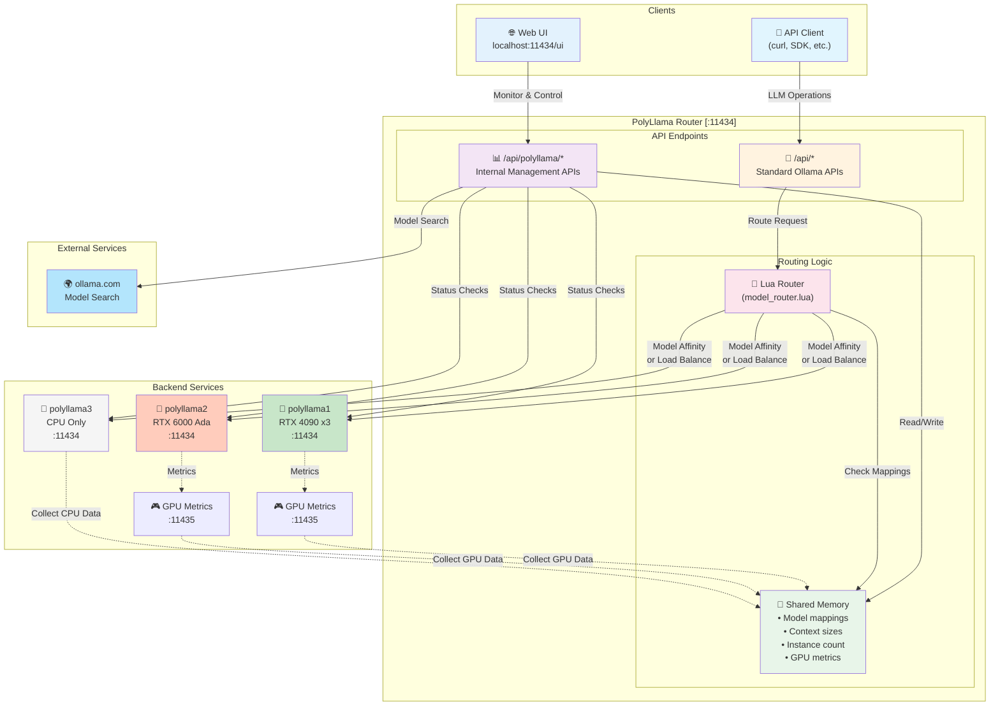
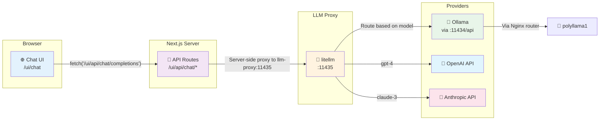
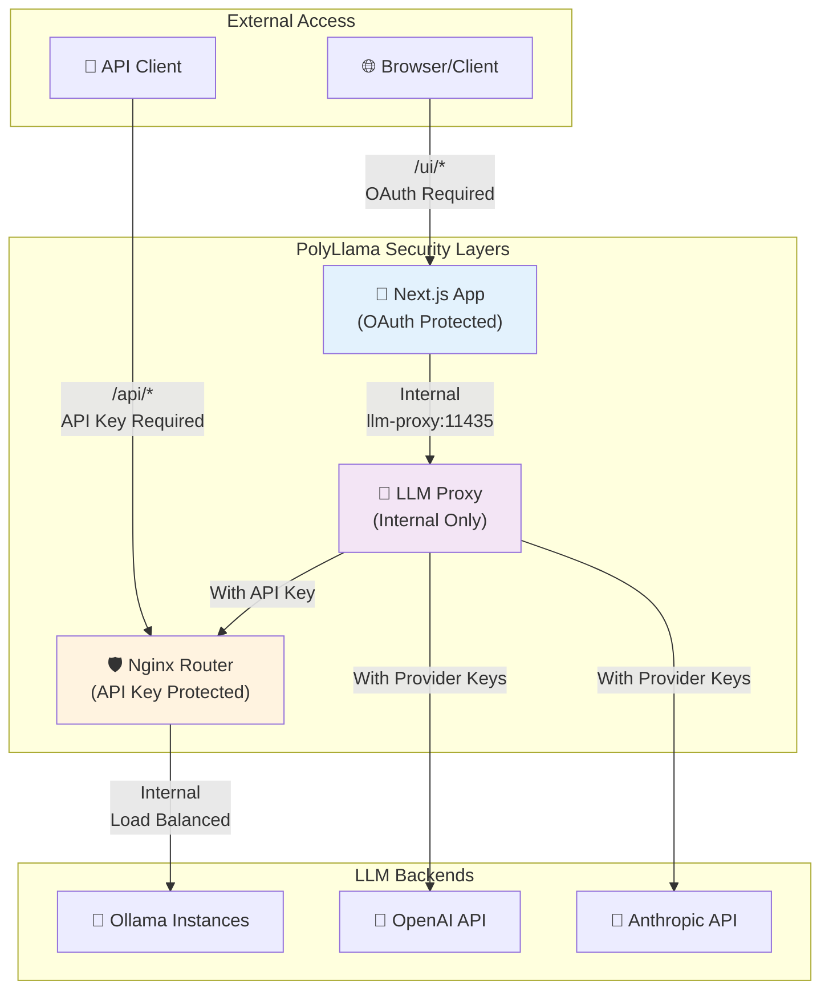

# 🦙 PolyLlama

[](https://github.com/mode3cloud/polyllama/actions/workflows/ci.yml)
[](https://mode3cloud.github.io/PolyLlama/)

## Dynamic, Multi-Instance Ollama Orchestration for Local AI Power

PolyLlama is an open source stack for running [Ollama](https://ollama.com) in advanced local and homelab environments. It **automatically detects your hardware**, intelligently groups GPUs, dynamically generates Docker Compose configs, and provides powerful routing, load balancing, and monitoring for LLM workloads.

> PolyLlama makes it trivial to harness all your GPUs and CPUs for generative AI—no manual configuration required.

---

## 📷 Screenshots

### Launch `./polyllama.sh`


### UI Console `http://localhost:11434/`


### Load Model


---

## 🏗️ Dynamic Architecture

PolyLlama **discovers your system’s capabilities** and generates the optimal deployment—whether you have a single GPU, a mixed multi-GPU workstation, or a humble CPU-only server.

### 🎯 **Automatic GPU Detection & Grouping**

* **Detects all NVIDIA GPUs** via `nvidia-smi` (using consistent PCI bus ordering)
* **Groups identical GPU models** together for maximal efficiency
* **Creates dedicated Ollama instances** per group, auto-setting `CUDA_VISIBLE_DEVICES`
* **Generates** `generated-compose.yml` on-the-fly using a Jinja2 template

### 📊 **Example Configurations**

#### Multi-GPU Workstation



#### Gaming Laptop



#### CPU-Only System



---

## 🔀 API Request Flow Architecture

### Direct Ollama API Calls

When you make requests to `localhost:11434/api/*`, PolyLlama intelligently routes them:

#### PolyLlama Internal Endpoints

These endpoints provide PolyLlama-specific functionality and are protected by the same API key authentication as standard Ollama endpoints when `POLYLLAMA_API_KEY` is configured.

| Endpoint | Method | Description | Implementation |
|----------|--------|-------------|----------------|
| `/api/polyllama/instance-status` | GET | Returns health status of all PolyLlama instances | Polls each instance's `/api/version` endpoint |
| `/api/polyllama/instance-count` | GET | Returns the number of configured instances | Reads from shared memory `OLLAMA_INSTANCE_COUNT` |
| `/api/polyllama/gpu-config` | GET | Returns GPU configuration and instance mapping | Static config from build-time template |
| `/api/polyllama/gpu-metrics` | GET | Returns real-time GPU/CPU metrics for all instances | Collects from instance metrics endpoints every 2s |
| `/api/polyllama/running-models` | GET | Returns all currently loaded models across instances | Aggregates from all instance `/api/ps` endpoints |
| `/api/polyllama/model-details` | POST | Get detailed info for a specific model | Routes to appropriate instance's `/api/show` |
| `/api/polyllama/model-mappings` | GET | Returns model-to-instance mappings and cache | Shows internal routing state |
| `/api/polyllama/get-contexts` | GET | Returns stored context lengths for models | Reads from shared memory context cache |
| `/api/polyllama/store-context` | POST | Stores context length for a model | Writes to shared memory for num_ctx tracking |
| `/api/polyllama/clean-mappings` | POST | Removes mappings for unloaded models | Cleans up stale routing entries |
| `/api/polyllama/duplicate-models` | GET | Detects models loaded on multiple instances | Helps identify routing issues |
| `/api/polyllama/sync-contexts` | POST | Syncs context sizes from running models | Updates context cache from loaded models |
| `/api/polyllama/search-models` | GET | Search models on ollama.com | Proxies to ollama.com model search |
| `/api/polyllama/pull-model` | POST | Initiate model pull to specific instance | Starts async model download |
| `/api/polyllama/pull-status` | GET | Get status of a model pull operation | Tracks download progress |
| `/api/polyllama/pull-statuses` | GET | Get all active pull operations | Lists all ongoing downloads |
| `/api/*` | ALL | Standard Ollama API endpoints | Load-balanced routing with model affinity |



#### How PolyLlama Routes Requests

1. **Internal Management APIs** (`/api/polyllama/*`)
   * Used by the Web UI for monitoring and control
   * Direct access to shared memory for instant status
   * Aggregate data from all instances (models, metrics, status)
   * Manage model downloads and routing configuration

2. **Standard Ollama APIs** (`/api/*`)
   * Compatible with all Ollama clients and SDKs
   * Smart routing based on model affinity
   * Automatic load balancing for new models
   * Context size preservation across requests

3. **Shared Memory Store**
   * Model-to-instance mappings for sticky routing
   * Context sizes to maintain model performance
   * GPU/CPU metrics updated every 2 seconds
   * Instance configuration from startup

### Web UI Chat Interface Flow
The chat interface uses a multi-tier architecture for provider flexibility:



**Key Architecture Points:**
- **Server-side only**: Browser never directly calls Docker services
- **Unified endpoint**: Everything accessible via `localhost:11434`
- **Smart routing**: Models automatically distributed across instances
- **Multi-provider**: Chat UI supports Ollama, OpenAI, Anthropic, etc.

---

## 🚀 Quick Start

### 1. **Clone the Repo**

```bash
git clone https://github.com/your-org/polyllama.git
cd polyllama
```

### 2. **Run the Launch Script**

```bash
# Auto-detect hardware and launch
./polyllama.sh

# See detected configuration
./polyllama.sh --detect

# Stop all services
./polyllama.sh --stop

# View logs
./polyllama.sh --logs

# Check status
./polyllama.sh --status
```

* **Dynamic Detection:**

  * *Multiple GPU types:* Each group gets its own instance
  * *Single GPU type:* All GPUs pooled for one instance
  * *No GPUs:* CPU-only Ollama
  * *Generates* `generated-compose.yml` dynamically

---

## 🌐 Access Points

* **Model Management Web UI**: [http://localhost:11434/ui/](http://localhost:11434/ui/)
* **Open Web UI (for local testing)**: [http://localhost:5000/](http://localhost:5000/)
* **API Endpoint**: [http://localhost:11434/api/](http://localhost:11434/api/)
* **Olah Mirror (for more efficient multi container HF downloads)**: [http://localhost:8090/](http://localhost:8090/)

---

## ✨ Features

* **Auto Hardware Discovery** (NVIDIA/CPU)
* **Dynamic Instance Grouping** (per GPU model)
* **Intelligent Model Routing & Load Balancing**
* **Context-Aware Model Loading**
* **Customizable via .env**
* **Modern Web UI for Monitoring & Management**
* **Nginx Proxy for Scalable Access**
* **Scripted Health Checks and Real-Time Status**

---

## 🖥️ Web Interface

* See all PolyLlama/Ollama instances, GPUs, and loaded models
* One-click model load/unload
* Set custom context lengths and manage assignments
* Visualize routing and system status live

---

## 🔧 Configuration

**Copy the `.env.example` to `.env` and set:**

```bash
POLYLLAMA_API_KEY=<your_api_key>  # Optional: API key to protect /api endpoints
HF_TOKEN=<your_hf_token>          # HuggingFace token for model access
```

### API Key Protection (Optional)
If `POLYLLAMA_API_KEY` is set, ALL `/api/*` endpoints (including both Ollama and PolyLlama management endpoints) will require authentication via one of:
- `api-key: <your_api_key>` header
- `x-api-key: <your_api_key>` header  
- `Authorization: Bearer <your_api_key>` header

---

## 🔒 Security Architecture

PolyLlama implements a comprehensive security model with multiple layers of authentication to protect LLM access:

### Authentication Overview



### Security Layers

#### 1. **Web UI Access (`/ui/*` routes)**
- **Protection**: Azure OAuth / OIDC authentication
- **Scope**: All UI pages and `/ui/api/*` endpoints
- **Implementation**: Next.js middleware validates OAuth tokens
- **Use Case**: Interactive web access for authenticated users

#### 2. **API Access (`/api/*` routes)**
- **Protection**: POLYLLAMA_API_KEY authentication
- **Scope**: ALL `/api/*` endpoints including:
  - Standard Ollama API endpoints (e.g., `/api/generate`, `/api/chat`)
  - PolyLlama management endpoints (e.g., `/api/polyllama/instance-status`)
- **Implementation**: Nginx Lua scripts validate API keys
- **Supported Headers**:
  - `api-key: <your_api_key>`
  - `x-api-key: <your_api_key>`
  - `Authorization: Bearer <your_api_key>`
- **Use Case**: Direct API access for external applications and management tools

#### 3. **LLM Proxy (Internal Only)**
- **Protection**: No external access (no exposed ports)
- **Access**: Only via internal Docker network (`http://llm-proxy:11435`)
- **Purpose**: Unified interface for multiple LLM providers
- **Authentication**: Automatically includes POLYLLAMA_API_KEY when calling Ollama

### Request Flow Examples

#### Example 1: Web UI Chat Request
```
Browser → /ui/api/chat/completions (OAuth required)
  → Next.js validates OAuth token
  → Next.js server → http://llm-proxy:11435/api/chat/completions
  → LLM Proxy routes to appropriate provider:
    - If Ollama model: → http://router:11434/api/chat (with POLYLLAMA_API_KEY)
    - If OpenAI model: → OpenAI API (with OPENAI_API_KEY)
    - If Anthropic model: → Anthropic API (with ANTHROPIC_API_KEY)
```

#### Example 2: Direct API Request
```
External Client → /api/generate (POLYLLAMA_API_KEY required)
  → Nginx validates API key
  → Nginx load balances to Ollama instance
  → Response returned to client
```

### Security Benefits

1. **No Direct LLM Access**: External clients cannot directly access the LLM proxy or individual Ollama instances
2. **Dual Authentication**: Different authentication methods for different use cases (OAuth for UI, API key for programmatic access)
3. **Internal Service Isolation**: LLM proxy is completely isolated from external access
4. **Credential Protection**: Provider API keys (OpenAI, Anthropic) are never exposed to clients
5. **Audit Trail**: All requests are authenticated and can be logged for security auditing

### Configuration

To enable full security:

1. **Set OAuth Provider** (for UI access):
   ```bash
   # In .env file
   OAUTH_CLIENT_ID=your-oauth-client-id
   OAUTH_CLIENT_SECRET=your-oauth-client-secret
   OAUTH_ISSUER=https://your-oauth-provider.com
   ```

2. **Set API Key** (for API access):
   ```bash
   # In .env file
   POLYLLAMA_API_KEY=your-secure-api-key
   ```

3. **Set LLM Provider Keys** (as needed):
   ```bash
   # In .env file
   OPENAI_API_KEY=your-openai-key
   ANTHROPIC_API_KEY=your-anthropic-key
   ```

---

## 📊 Monitoring & Management

* **Health:** Real-time status for all PolyLlama instances
* **Resource Usage:** GPU/CPU memory, model assignments
* **Load Balancing:** Least-connections with failover
* **Logs & Debugging:** Scripted helpers and Compose logs

---

## 🛠️ Advanced Usage

* **Custom Model Loading:**
  Use the UI to load/unload models, set context, and assign to instances
* **Direct API:**
  Target automatic routing or force a specific instance via API

---

## 🐛 Troubleshooting

```bash
./polyllama.sh --status
./polyllama.sh --logs
docker-compose logs polyllama1    # View logs for a specific instance
docker run --rm --gpus all nvidia/cuda:11.0-base nvidia-smi
docker exec polyllama1 nvidia-smi # Check GPU access in running instance
```

**Reset Everything:**

```bash
./polyllama.sh --stop
docker system prune -f
./polyllama.sh
```

---

## 🤝 Contributing

PolyLlama is **open source** and welcomes community involvement!

* **Code contributions** (detection logic, new features, UI)
* **Docs & How-tos**
* **Bug reports & feature requests**
* **Testing on unique hardware**
* **LLM-based UX helpers**

Want to get involved? [Open an issue](https://github.com/mode3cloud/polyllama/issues) or [start a discussion](https://github.com/mode3cloud/polyllama/discussions)!

---

## 🛣️ Roadmap & Potential Future Ideas

Some cool directions PolyLlama could go next:

* **LLM-powered Config Wizard:**
  Use an LLM to interpret your hardware, usage goals, and preferences to generate an ideal configuration (including model placement, memory tuning, and advanced routing).
* **AMD & Apple GPU Support:**
  Expand beyond NVIDIA via ROCm/Metal backends as supported by Ollama and the community.
* **Unified Model Marketplace:**
  Integrated access to community models, HuggingFace, and private model hubs.
* **More Granular Model Pinning:**
  Assign specific models or jobs to preferred GPU classes or nodes.
* **User Profiles & Access Control:**
  Fine-tune who can manage or use PolyLlama.
* **Cluster/Networked Mode:**
  Deploy PolyLlama across several physical nodes (for true AI at scale).
* **Metrics & Alerting Integrations:**
  Prometheus/Grafana or Discord/Slack bots for real-time health alerts.
* **Self-Updating Stack:**
  Automated update flow for the full system (including dependencies).

Have ideas or want to help build the next phase? **Contributions are encouraged!**

---

## License

[MIT License](LICENSE)

---

## Credits

PolyLlama is built on the excellent [Ollama](https://ollama.com) open source project, and includes [Open WebUI](https://github.com/open-webui/open-webui) for ease of testing and [Olah](https://github.com/vtuber-plan/olah) to reduce multiple model downloads.

🦙🦙🦙 Thanks to all AI and open hardware enthusiasts whose work makes local AI possible! 🦙🦙🦙

---

*Let the llamas run wild on your silicon.*
— The PolyLlama Team

---
