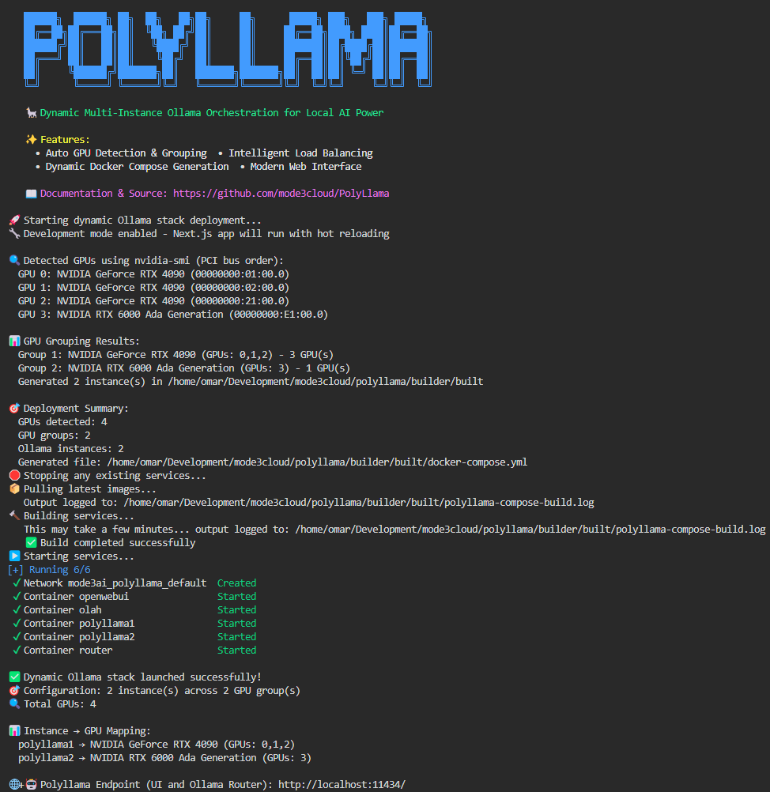
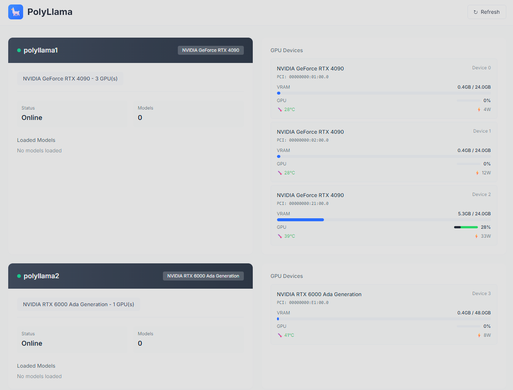
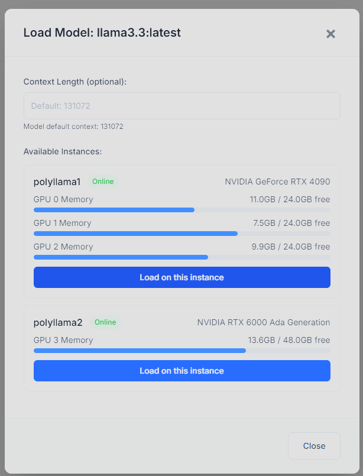
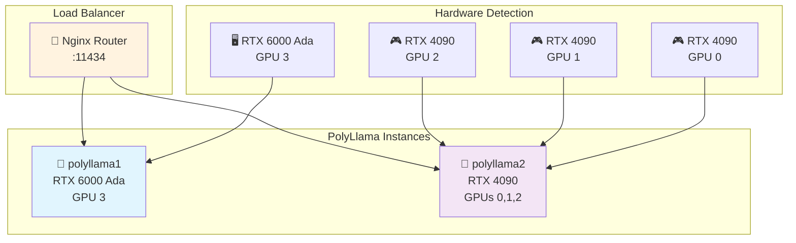
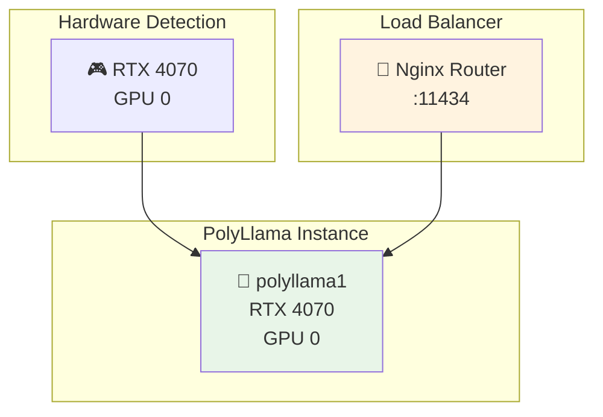
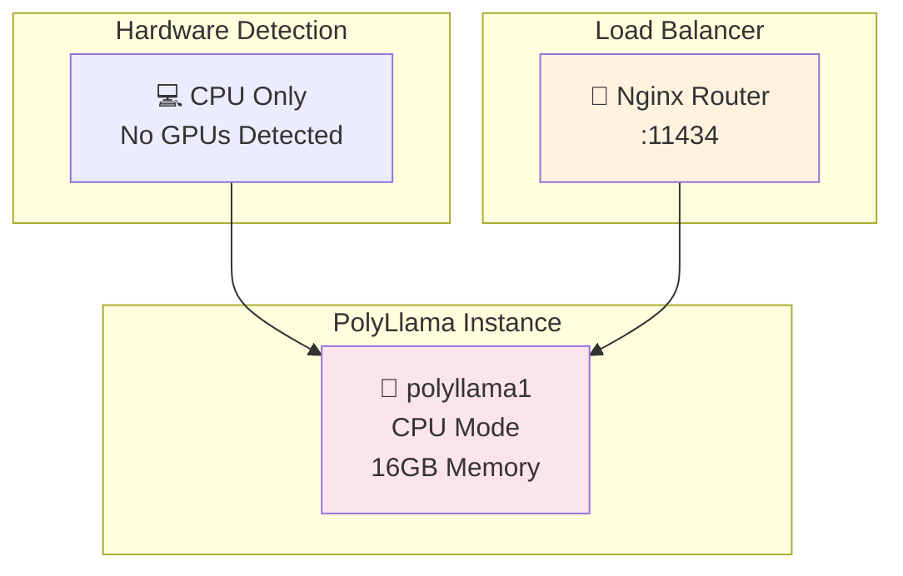
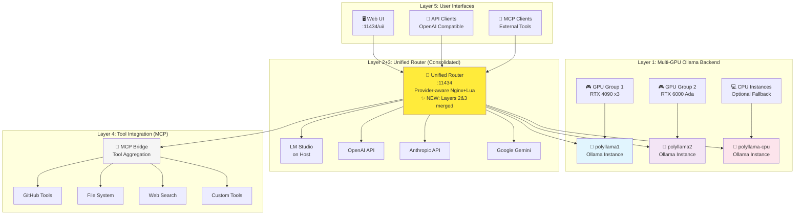
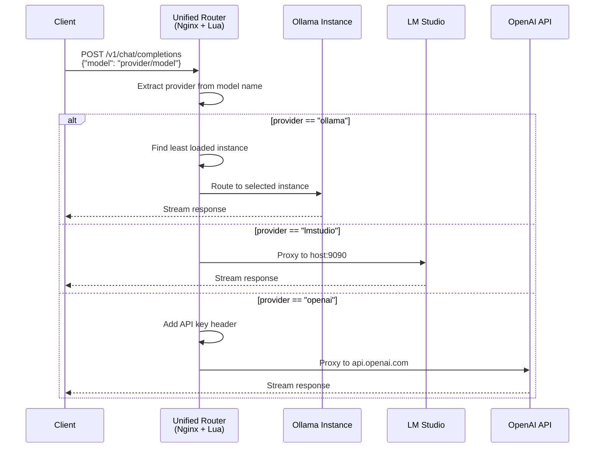

# 🦙 PolyLlama

[](https://github.com/mode3cloud/polyllama/actions/workflows/ci.yml)
[](https://mode3cloud.github.io/PolyLlama/)

## The Complete Local AI Platform: Multi-GPU Ollama + Multi-Provider Gateway + Unified Tool Integration

PolyLlama is a comprehensive AI orchestration platform that transforms your hardware into a powerful, unified AI system. It combines **automatic multi-GPU Ollama orchestration** with a **multi-provider LLM gateway** and **universal tool integration** through the Model Context Protocol (MCP).

### 🎯 Key Capabilities

1. **🔧 Multi-GPU Ollama Backend**: Automatically detects and optimally configures all your GPUs for parallel Ollama instances
2. **🌐 Multi-Provider LLM Gateway**: Unified API supporting Ollama, LM Studio, OpenAI, Anthropic, Google, and more through a single interface
3. **🔌 Universal Tool Integration**: MCP support brings GitHub, filesystem, web search, and custom tools to any LLM provider
4. **🖥️ Unified Web Interface**: Provider-agnostic chat UI with PolyLlama-specific monitoring for GPU utilization

> Transform your multi-GPU setup into a production-ready AI platform with zero manual configuration—while maintaining the flexibility to use cloud providers when needed.

---

## 📷 Screenshots

### Launch `./polyllama.sh`



### UI Console `http://localhost:11434/`




### Load Model



---

## 🏗️ Dynamic Architecture

PolyLlama **discovers your system’s capabilities** and generates the optimal deployment—whether you have a single GPU, a mixed multi-GPU workstation, or a humble CPU-only server.

### 🎯 **Automatic GPU Detection & Grouping**

* **Detects all NVIDIA GPUs** via `nvidia-smi` (using consistent PCI bus ordering)
* **Groups identical GPU models** together for maximal efficiency
* **Creates dedicated Ollama instances** per group, auto-setting `CUDA_VISIBLE_DEVICES`
* **Generates** `generated-compose.yml` on-the-fly using a Jinja2 template

### 📊 **Example Configurations**

#### Multi-GPU Workstation



#### Gaming Laptop



#### CPU-Only System



## 🏛️ Service Architecture

PolyLlama implements a sophisticated multi-layer architecture that scales from local Ollama orchestration to unified multi-provider LLM access with integrated tool support.

### Architecture Layers



> **🆕 Unified Router Architecture**: We've consolidated Layers 2 and 3 into a single unified router! This eliminates the circular dependency where the LLM Proxy would route back through the Router for Ollama requests. The new architecture is simpler, faster, and maintains all functionality while reducing latency. The unified router intelligently routes based on model naming convention (provider/modelname).

#### Unified Router Benefits
- **🚀 Performance**: Eliminates extra network hop (30-40% latency reduction)
- **🎯 Simplicity**: Single routing layer instead of two separate services
- **🔧 Maintainability**: All routing logic in one place (`provider_router.lua`)
- **✨ Drop-in Replacement**: No changes needed to existing clients or UI
- **🔌 Extensibility**: Easy to add new providers with simple pattern matching

### Service Responsibilities

| Service | Port | Purpose | Key Features |
|---------|------|---------|-------------|
| **Unified Router** | 11434 | Entry point, load balancer, and provider gateway | Provider-aware routing, API authentication, multi-provider support |
| **Ollama Instances** | Internal | Dynamic GPU/CPU instances | Hardware-specific optimization, model caching, parallel inference |
| **LLM Proxy** | 11435 | *(Deprecated with Unified Router)* | Previously handled provider gateway, now integrated into router |
| **Agent Controller** | 11436 | Multi-agent orchestration | Tool execution, session management, workflow coordination |
| **MCP Bridge** | 3001 | MCP tool integration | Tool discovery, execution proxy, server management |
| **Kokoro TTS** | 8880 | Text-to-speech service | GPU-accelerated speech synthesis |
| **Redis** | 6379 | Caching and session storage | Agent state, tool results, session persistence |

### Multi-Provider LLM Support

PolyLlama's Unified Router provides a **unified OpenAI-compatible API** that routes to different providers based on model naming:

#### Provider Routing
```javascript
// Model naming convention determines provider routing
"llama3.2"                    → "ollama/llama3.2"        // Auto-prefixed (or lmstudio/ if configured)
"ollama/llama3.2:latest"      → Local Ollama backend
"lmstudio/qwen2.5-coder"      → LM Studio on host machine
"openai/gpt-4o"               → OpenAI API
"anthropic/claude-3-5-sonnet" → Anthropic API
"google/gemini-pro"           → Google Gemini API
"groq/mixtral-8x7b"           → Groq API
```

#### Unified API Endpoints
- **`/api/models`** - Returns all available models across all providers
- **`/api/chat/completions`** - OpenAI-compatible chat endpoint for any provider
- **`/api/sessions`** - Session management with Redis persistence
- **`/api/mcp/*`** - MCP tool management and execution

### MCP Tool Integration

The Model Context Protocol (MCP) integration provides **provider-agnostic tool support** through the MCP Bridge service:

#### MCP Bridge Architecture
The MCP Bridge is a standalone FastAPI service that:
- **Discovers Tools**: Connects to configured MCP servers and aggregates available tools
- **Manages Sessions**: Handles stateful tool interactions across requests
- **Executes Tools**: Proxies tool calls to appropriate MCP servers
- **Formats Responses**: Provides both raw MCP and OpenAI-compatible formats

#### Tool Flow
1. **Tool Discovery**: MCP Bridge connects to MCP servers at startup
2. **Tool Registration**: Available tools exposed via `/api/mcp/tools` endpoint
3. **Execution Proxy**: Router forwards tool calls to MCP Bridge
4. **Result Streaming**: SSE support for long-running tool operations

#### API Endpoints
- **`/api/mcp/status`** - Bridge health and connected servers
- **`/api/mcp/tools`** - Raw MCP tool format
- **`/api/mcp/tools/formatted`** - OpenAI-compatible tool format
- **`/api/mcp/execute`** - Tool execution endpoint
- **`/api/mcp/execute/stream`** - SSE streaming execution
- **`/api/mcp/refresh`** - Refresh tool discovery

#### Supported MCP Server Types
- **HTTP-based servers** - Direct REST API integration (fully supported)
- **npx-based servers** - Node.js servers via stdio (planned)
- **WebSocket servers** - Real-time bidirectional communication (planned)
- **Custom servers** - Any MCP-compliant implementation

### UI Architecture

The Web UI (`/ui/`) provides **provider-agnostic** chat and management interfaces:

#### Agnostic Features
- **Model Selection**: Unified dropdown showing all providers' models
- **Chat Interface**: Works identically regardless of provider
- **Tool Usage**: MCP tools available for all providers that support function calling
- **Session Management**: Consistent across all providers

#### PolyLlama-Specific Features
- **Instance Monitoring**: Real-time status of Ollama instances
- **GPU Utilization**: Visual representation of GPU usage
- **Model Routing**: Shows which instance is handling which model
- **Load Distribution**: Live view of request routing

### Data Flow Patterns

1. **Multi-Provider Chat Flow**:
   ```
   UI → Unified Router (:11434) → Provider Detection → Provider API → Response Stream
                                        ↓
                                  MCP Bridge (:3001) → Tool Execution (if needed)
   ```

2. **Ollama-Specific Flow**:
   ```
   UI → Unified Router (:11434) → Lua Routing → Specific Ollama Instance
                                      ↓
                           Model Assignment → GPU Group → Response
   ```

3. **Tool-Enhanced Flow**:
   ```
   Chat Request → Unified Router (:11434) → Provider API
                           ↓
                    Tool Detection → MCP Bridge (:3001) → MCP Server
                           ↓
                    Tool Results → LLM → Final Response
   ```

4. **MCP Bridge Integration**:
   ```
   Startup: MCP Bridge → Discover MCP Servers → Aggregate Tools
                ↓
   Runtime: Router → /api/mcp/* → MCP Bridge → Execute Tool → Return Result
                                       ↓
                                 Session Management (Redis)
   ```

---

## 🔗 How It All Works Together

PolyLlama creates a seamless AI platform through intelligent layering:

1. **Hardware Layer**: `./polyllama.sh` detects your GPUs and automatically creates optimal Ollama instances
2. **Routing Layer**: Unified Router (Nginx with Lua) intelligently routes requests based on provider and model availability
3. **Provider Layer**: The Unified Router translates between a unified API and provider-specific formats (Ollama, OpenAI, Anthropic, etc.)
4. **Tool Layer**: MCP Bridge enables any provider to use tools - GitHub PR creation works the same whether using local Llama or GPT-4
5. **Interface Layer**: The Web UI presents everything through a clean, unified interface - select any model from any provider and use tools seamlessly

**Example Flow**:
- User selects "anthropic/claude-3-5-sonnet" in the UI
- Request goes through Unified Router → Provider Detection → Anthropic API
- If user selects "ollama/llama3.2", same UI, same tools: Unified Router → Ollama Instance Selection → Specific GPU Instance
- Tools work identically in both cases through the MCP Bridge

---

## 🔀 Unified Router Deep Dive

The Unified Router is the core innovation that makes PolyLlama both powerful and simple. Here's how it works:

### Request Flow



### Provider Detection Algorithm

```lua
-- provider_router.lua
function extract_provider_from_model(model)
    -- Check for explicit provider prefix
    local provider, model_name = model:match("^([^/]+)/(.+)$")

    if not provider then
        -- No prefix - apply default logic
        if LMSTUDIO_API_BASE configured then
            return "lmstudio", model
        else
            return "ollama", model
        end
    end

    return provider, model_name
end
```

### Unified Endpoints

| Endpoint | Method | Description | Example |
|----------|--------|-------------|---------|
| `/v1/chat/completions` | POST | Universal chat endpoint | Works with any provider |
| `/v1/models` | GET | List all models from all providers | Returns unified model list |
| `/api/*` | ANY | Ollama-specific endpoints | Maintained for compatibility |

### Adding New Providers

Adding a new provider is as simple as extending the router:

```lua
-- In provider_router.lua
elseif provider == "newprovider" then
    api_base = "https://api.newprovider.com/v1"
    api_key = env_vars:get("NEWPROVIDER_API_KEY")
    -- Add any provider-specific headers
    extra_headers["X-Custom-Header"] = "value"
```

### Performance Optimizations

1. **Smart Caching**: Model-to-instance mappings cached in Nginx shared memory
2. **Connection Pooling**: Reuses connections to backend services
3. **Load Balancing**: Distributes requests across Ollama instances by model count
4. **Streaming**: Direct stream proxying without buffering
5. **Header Passthrough**: Minimal header manipulation for lower latency

## 🚀 Quick Start

### 1. **Clone the Repo**

```bash
git clone https://github.com/your-org/polyllama.git
cd polyllama
```

### 2. **Run the Launch Script**

```bash
# Auto-detect hardware and launch
./polyllama.sh

# See detected configuration
./polyllama.sh --detect

# Stop all services
./polyllama.sh --stop

# View logs
./polyllama.sh --logs

# Check status
./polyllama.sh --status
```

* **Dynamic Detection:**

  * *Multiple GPU types:* Each group gets its own instance
  * *Single GPU type:* All GPUs pooled for one instance
  * *No GPUs:* CPU-only Ollama
  * *Generates* `generated-compose.yml` dynamically

---

## 🌐 Access Points

* **Model Management Web UI**: [http://localhost:11434/ui/](http://localhost:11434/ui/)
* **Open Web UI (for local testing)**: [http://localhost:5000/](http://localhost:5000/)
* **API Endpoint**: [http://localhost:11434/api/](http://localhost:11434/api/)
* **Olah Mirror (for more efficient multi container HF downloads)**: [http://localhost:8090/](http://localhost:8090/)

---

## ✨ Features

* **Auto Hardware Discovery** (NVIDIA/CPU)
* **Dynamic Instance Grouping** (per GPU model)
* **Intelligent Model Routing & Load Balancing**
* **Context-Aware Model Loading**
* **Customizable via .env**
* **Modern Web UI for Monitoring & Management**
* **Nginx Proxy for Scalable Access**
* **Scripted Health Checks and Real-Time Status**

---

## 🖥️ Web Interface

* See all PolyLlama/Ollama instances, GPUs, and loaded models
* One-click model load/unload
* Set custom context lengths and manage assignments
* Visualize routing and system status live

---

## 🔧 Configuration

### Basic Setup

**Copy the `.env.example` to `.env` and configure:**

```bash
# Core Configuration
HF_TOKEN=<your_hf_token>           # HuggingFace token for model access
POLYLLAMA_API_KEY=<your_key>       # Optional: API key for securing endpoints

# Multi-Provider API Keys (Optional - enables additional providers)
OPENAI_API_KEY=<your_openai_key>
ANTHROPIC_API_KEY=<your_anthropic_key>
GOOGLE_API_KEY=<your_google_key>
GROQ_API_KEY=<your_groq_key>

# LM Studio Configuration (Optional - for local LM Studio server)
LMSTUDIO_API_BASE=host.docker.internal:9090  # Or your LM Studio host:port
LMSTUDIO_API_KEY=<optional_api_key>           # Only if LM Studio requires auth

# Hardware Configuration
POLYLLAMA_CPU_INSTANCES=0          # Number of CPU-only instances
POLYLLAMA_MIXED_MODE=false         # Enable mixed GPU+CPU mode
POLYLLAMA_CPU_ROUTING_MODE=prefer_gpu  # CPU routing: prefer_gpu|balanced|gpu_only
```

### Provider Configuration

The system automatically detects available providers based on configured API keys:

- **No API keys**: Only local Ollama models available
- **With LM Studio configured**: Adds all models loaded in LM Studio on your host
- **With OpenAI key**: Adds GPT-4, GPT-3.5, and other OpenAI models
- **With Anthropic key**: Adds Claude 3.5, Claude 3, and other Anthropic models
- **Multiple keys**: All providers available with unified model selection

#### LM Studio Setup

LM Studio provides a local OpenAI-compatible API server for running models on your host machine:

1. **Install LM Studio** on your host machine (not in Docker)
2. **Load models** in LM Studio's UI
3. **Start the server** (usually on port 9090)
4. **Configure PolyLlama**: Set `LMSTUDIO_API_BASE` in `.env`
5. **Access models**: Use `lmstudio/model-name` prefix in PolyLlama

##### Windows Firewall Configuration (WSL Users)

If running LM Studio on Windows with PolyLlama in WSL, you need to allow inbound connections:

```powershell
# Run in Windows PowerShell as Administrator
netsh advfirewall firewall add rule name="LM Studio 9090" dir=in action=allow protocol=TCP localport=9090 profile=private
```

This allows WSL containers to connect to LM Studio running on the Windows host.

### MCP Tool Configuration

The MCP Bridge service enables tool integration across all LLM providers. Configure your MCP servers in `mcp-config.json`:

```json
{
  "mcpServers": {
    "github": {
      "command": "npx",
      "args": ["-y", "@modelcontextprotocol/server-github"],
      "env": {
        "GITHUB_PERSONAL_ACCESS_TOKEN": "your-token"
      }
    },
    "filesystem": {
      "command": "npx",
      "args": ["-y", "@modelcontextprotocol/server-filesystem", "/path/to/allowed/directory"]
    },
    "custom-http-server": {
      "command": "mcp-remote",
      "args": ["http://localhost:8080/mcp"]
    }
  }
}
```

#### MCP Bridge Service

The MCP Bridge runs as a separate Docker container and provides:

- **Automatic Discovery**: Connects to all configured MCP servers on startup
- **Tool Aggregation**: Combines tools from multiple sources into a unified catalog
- **Protocol Translation**: Converts between MCP protocol and OpenAI function-calling format
- **Health Monitoring**: Tracks server connectivity and tool availability
- **Hot Reload**: Refresh tool catalog without restarting (`/api/mcp/refresh`)

#### Current Limitations

- **HTTP-based servers**: Fully supported with direct REST API integration
- **npx-based servers**: Not yet supported (requires stdio/WebSocket bridge implementation)
- **Authentication**: Server-specific auth configured in `mcp-config.json`

---

## 📊 Monitoring & Management

* **Health:** Real-time status for all PolyLlama instances
* **Resource Usage:** GPU/CPU memory, model assignments
* **Load Balancing:** Least-connections with failover
* **Logs & Debugging:** Scripted helpers and Compose logs

---

## 🛠️ Advanced Usage

* **Custom Model Loading:**
  Use the UI to load/unload models, set context, and assign to instances
* **Direct API:**
  Target automatic routing or force a specific instance via API

---

## 🐛 Troubleshooting

```bash
./polyllama.sh --status
./polyllama.sh --logs
docker compose logs polyllama1    # View logs for a specific instance
docker run --rm --gpus all nvidia/cuda:11.0-base nvidia-smi
docker exec polyllama1 nvidia-smi # Check GPU access in running instance
```

**Reset Everything:**

```bash
./polyllama.sh --stop
docker system prune -f
./polyllama.sh
```

---

## 🤝 Contributing

PolyLlama is **open source** and welcomes community involvement!

* **Code contributions** (detection logic, new features, UI)
* **Docs & How-tos**
* **Bug reports & feature requests**
* **Testing on unique hardware**
* **LLM-based UX helpers**

Want to get involved? [Open an issue](https://github.com/mode3cloud/polyllama/issues) or [start a discussion](https://github.com/mode3cloud/polyllama/discussions)!

---

## 🛣️ Roadmap & Potential Future Ideas

Some cool directions PolyLlama could go next:

* **LLM-powered Config Wizard:**
  Use an LLM to interpret your hardware, usage goals, and preferences to generate an ideal configuration (including model placement, memory tuning, and advanced routing).
* **AMD & Apple GPU Support:**
  Expand beyond NVIDIA via ROCm/Metal backends as supported by Ollama and the community.
* **Unified Model Marketplace:**
  Integrated access to community models, HuggingFace, and private model hubs.
* **More Granular Model Pinning:**
  Assign specific models or jobs to preferred GPU classes or nodes.
* **User Profiles & Access Control:**
  Fine-tune who can manage or use PolyLlama.
* **Cluster/Networked Mode:**
  Deploy PolyLlama across several physical nodes (for true AI at scale).
* **Metrics & Alerting Integrations:**
  Prometheus/Grafana or Discord/Slack bots for real-time health alerts.
* **Self-Updating Stack:**
  Automated update flow for the full system (including dependencies).

Have ideas or want to help build the next phase? **Contributions are encouraged!**

---

## License

[MIT License](LICENSE)

---

## Credits

PolyLlama is built on the excellent [Ollama](https://ollama.com) open source project, and includes [Open WebUI](https://github.com/open-webui/open-webui) for ease of testing and [Olah](https://github.com/vtuber-plan/olah) to reduce multiple model downloads.

🦙🦙🦙 Thanks to all AI and open hardware enthusiasts whose work makes local AI possible! 🦙🦙🦙

---

*Let the llamas run wild on your silicon.*
— The PolyLlama Team

---
